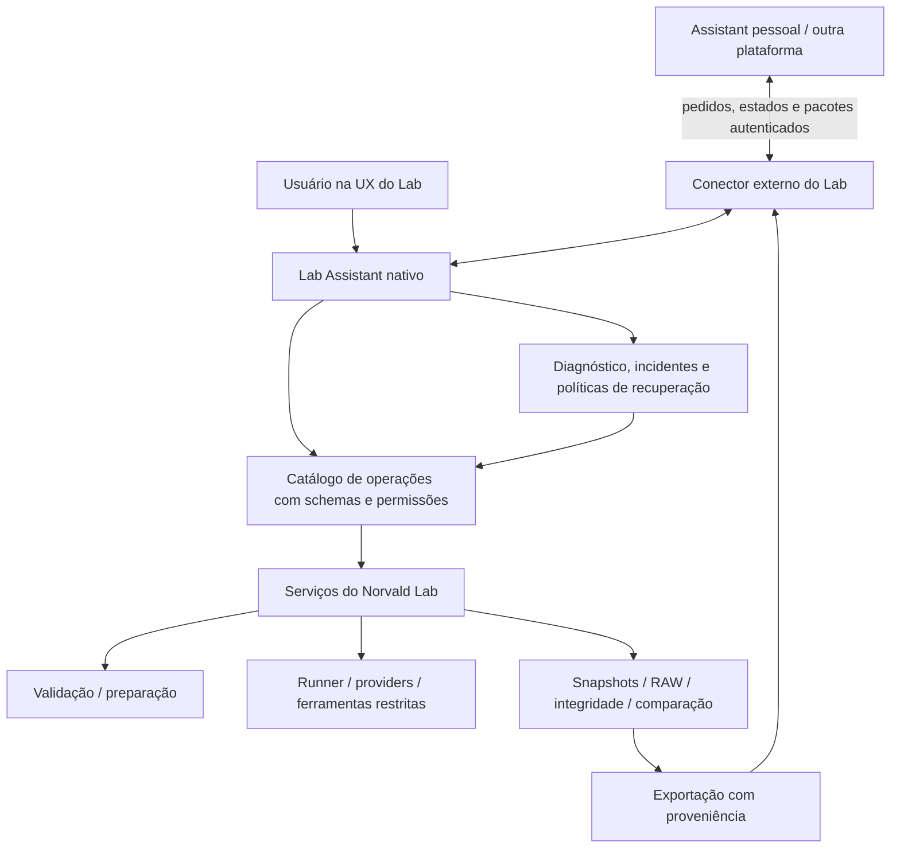

# Lab Assistant — proposta de arquitetura e recuperação por critérios

**Estado:** proposta para discussão; não implementada nem aprovada como alteração de comportamento.  
**Data:** 2026-10-15  
**Repositório de destino:** `edubrinck86-code/Norvald-Lab`, branch `main`.  
**Referência de reutilização:** `edubrinck86-code/Norvald-Huginn`, branch `main`.

## 1. Objetivo

Criar um **Assistant nativo do Norvald Lab**, capaz de planejar, preencher, conferir, executar, acompanhar, diagnosticar, comparar e exportar estudos. Ele poderá conversar diretamente com o usuário no Lab e trocar solicitações/resultados estruturados com o Assistant pessoal hospedado em outra plataforma.

O Assistant pessoal não precisa implementar ou conhecer os detalhes do `Spec`, AROF, providers, execução e integridade. O Lab Assistant opera exclusivamente por contratos do próprio laboratório.

Não fundir aplicativos, dados ou credenciais. O Lab permanece independente do Huginn, do Studio e da plataforma externa.

## 2. Princípios inegociáveis

1. **Instrumento soberano:** validadores, `runner`, invariantes experimentais, fechamento e integridade do Lab são a autoridade. A LLM não aprova seu próprio trabalho.
2. **RAW imutável:** resposta coletada, request, contexto, manifesto e logs originais não podem ser corrigidos, reescritos ou substituídos por uma interpretação do Assistant.
3. **Recuperação não é aprovação retroativa:** um ajuste assistido e uma nova coleta têm identidade, proveniência e validação próprias; não se tornam silenciosamente a observação cega original.
4. **Condição congelada:** B1 (`blind`), B3 (`self`) e E (`exposed`) preservam origem íntegra, documentos, participantes, repetições e regras de exposição pareada. O modelo de um participante não pode ser trocado automaticamente no meio de uma coleta.
5. **Declarado ≠ validado:** guardar sempre o que foi declarado, o que foi aceito, o que foi rejeitado e a justificativa verificável; aceitação parcial não significa conformidade completa.
6. **Operação rastreável:** cada ação do Assistant deve possuir ator, argumento não sensível, autorização, motivo, resultado confirmado, referências aos registros e carimbo temporal.
7. **Escopo mínimo de permissão:** consultas, organização, início de experimentos, gestão de credenciais e ações destrutivas exigem níveis diferentes de autorização; sem acesso irrestrito a arquivos ou sistema.
8. **Execução local por padrão:** sem exposição direta da API local à internet; conectar plataforma externa por transporte autenticado, com pareamento, escopo, redaction e transferência de dados consentida.
9. **Sem duplicar motores:** reutilizar/adaptar peças do Huginn no Lab sem substituir o `runner`, inventar outro parser ou depender de processo Huginn ativo.
10. **Separar operador de objeto de estudo:** o modelo usado pelo Lab Assistant não vira participante experimental nem altera o corpus de um estudo sem instrução explícita.

## 3. Fronteiras e comunicação



**Controle (entrada):** descoberta de operações, configurações, catálogos, construção/validação de `Spec`, autorização de execução, status e solicitação de ajustes permitidos.

**Observação (saída):** estados, eventos, requests preparados, respostas, reasoning efetivamente disponibilizado, contribuições declaradas/aceitas/rejeitadas, integridade, comparação e pacotes de evidências com identificadores e hashes.

**Não expor** credenciais, caminhos arbitrários, dados privados não selecionados ou métodos de administração sem autenticação e autorização. Comunicação assíncrona não deve exigir manter uma conversa aberta durante toda a coleta.

## 4. Capacidades desejadas

- **Planejador:** interpreta objetivo, define participantes, modelos/providers, instruções, corpus, exposição, repetições e limites; explica escolhas e incertezas, inclusive custo quando houver metadados suficientes.
- **Operador:** usa operações tipadas para consultar conexões/catálogos, preparar, apresentar o contrato final, obter aprovação e executar.
- **Observador:** lê status, eventos, snapshots, diagnósticos, falhas e integridade; retoma observação após interrupção.
- **Motor de conformidade:** associa critérios do protocolo a verificações determinísticas e suas evidências; apresenta `atendido`, `não_atendido`, `parcial`, `não_avaliável` ou `pendente`.
- **Recuperador:** recomenda ou executa apenas ações permitidas, com orçamento de tentativas, autorizações, idempotência e nova validação.
- **Analista:** separa comparação descritiva, interpretação assistida e inferências não autorizadas pela evidência.
- **Comunicador:** disponibiliza tarefas e pacotes de resultado ao Assistant pessoal, sem exigir que este implemente detalhes internos do Lab.

São **funções de um Assistant com ferramentas**, não obrigatoriamente sete agentes/modelos independentes.

## 5. Tratamento de erros como descumprimento de critérios

O problema principal não é apenas falha HTTP ou provider indisponível. É identificar **condições exigidas pelo framework que não foram satisfeitas**, tanto na preparação quanto nas respostas e no fechamento.

### 5.1 Classes de ocorrência

| Classe | Exemplo | Ação admissível |
| --- | --- | --- |
| Preparação/configuração | campo obrigatório ausente; limites incoerentes; provider não resolvido | corrigir rascunho `Spec` **antes** da coleta e revalidar |
| Dependência experimental | origem incompleta ou não íntegra; pareamento/condição inválidos | corrigir planejamento, aguardar origem válida ou planejar **nova** coleta |
| Contribuição/estrutura | item de `CONTRIBUTION` ausente, malformado ou rejeitado | preservar RAW; registrar diagnóstico; propor ajuste assistido separado |
| Integridade/proveniência | hash inválido, snapshot ausente, inconsistência de manifesto | bloquear uso como evidência íntegra; investigar e escalar |
| Transporte/provider | autenticação, quota, timeout, incompatibilidade | tratar operacionalmente sem mudar identidade experimental |
| Critério interpretativo | consistência semântica, qualidade, influência/causalidade | sinalizar necessidade de avaliação; **não** converter opinião da LLM em validação formal |

O mesmo critério pode produzir `não_avaliável` em vez de `não_atendido` se a coleta não fornecer observação suficiente. A definição formal de cada regra é responsabilidade do framework/protocolo, não da LLM.

### 5.2 Estados e trilha de recuperação

```text
detecção -> diagnóstico com evidência -> classificação e política
         -> [corrigir rascunho | solicitar aprovação | ajustar separadamente
             | agendar nova coleta | preservar e escalar]
         -> nova validação -> registro de desfecho ou pendência
```

Cada ocorrência proposta deve conter: `incident_id`, `criterion_id`, `criterion_version`, `scope` (spec/condição/observação/ajuste/integridade), `experiment_id`, `observation_id?`, `severity`, `status`, `validator_code?`, `evidence_refs`, `proposed_action`, `approval`, `attempts`, `resolution`, datas e vínculo com incidentes relacionados. Nomes e esquema são **propostos**, não APIs existentes.

Códigos de classificação **propostos**: `criterion_missing`, `contribution_invalid`, `source_condition_invalid`, `pairing_incomplete`, `context_inconsistent`, `integrity_failed`. Não substituir códigos reais dos validadores por essas categorias; manter ambos.

### 5.3 Política de correção

- **Autoajuste pré-execução:** somente rascunhos/configuração dentro de regras explícitas; mudanças de desenho experimental e custo devem ser exibidas para aprovação antes de gastar recursos.
- **Durante a coleta:** retry operacional delimitado pode manter o pedido e identidade; nada de substituir modelo, instruções, exposição ou repetição sem novo experimento aprovado.
- **Pós-coleta:** se a LLM falhou em cumprir estrutura, registrar falha original e usar fluxo de ajuste separado quando autorizado. Não inserir conteúdo ausente diretamente no RAW.
- **Condição derivada:** uma contribuição inválida na base não se torna válida para B3/E apenas por ajuste posterior; é necessária nova base experimental adequada, sem substituir a anterior.
- **Fechamento:** o Assistant não torna `complete` sinônimo de integridade, conformidade estrutural ou validade científica.
- **Exceções:** se o validador não reconhecer regra/critério, abrir pendência de especificação ou revisão humana; não inventar conformidade.

## 6. Reutilização proposta do Huginn

Priorizar extração/adaptação **versionada** dos padrões e módulos, nunca importar o aplicativo Huginn em execução.

| Origem no Huginn | O que avaliar para o Lab | Observação |
| --- | --- | --- |
| `core/huginn/domains/operations/operation.py` e `catalogue.py` | nomes, classes de permissão, schemas Pydantic, auditoria | conservar serviços e permissões locais do Lab |
| `core/huginn/domains/assistant/tools.py` | `list_operations`, `describe_operation`, `call_operation` | limite de resposta e trilha de ferramenta |
| `core/huginn/domains/incidents/watch.py` | cursor de eventos, incidentes duráveis, falhas de processamento isoladas | não misturar com eventos RAW autoritativos |
| `core/huginn/domains/research/recovery.py` | taxonomia, diagnóstico, bloqueio e tentativas limitadas | **proibir troca automática** de participantes experimentais |
| `core/huginn/domains/providers/errors.py` | erros estruturados seguros | utilitário, não núcleo científico |
| `core/huginn/domains/research/scheduler.py` | tarefas dependentes, capacidade, pausa, coordenação | orquestrar tarefas do Assistant; não duplicar `runner` |
| `core/huginn/domains/routines/service.py` | recorrência, histórico, retomada | etapa posterior; retirar acoplamentos editoriais |

## 7. Proposta de catálogo do Lab (não implementado)

Leituras: `lab.settings.read`, `lab.providers.list`, `lab.models.catalog`, `lab.experiments.list`, `lab.experiment.status`, `lab.experiment.snapshot`, `lab.criteria.evaluate`, `lab.incidents.list`, `lab.results.export`.

Preparação: `lab.spec.template`, `lab.spec.validate`, `lab.spec.derive`, `lab.spec.editable_copy`, `lab.recovery.plan`.

Ações controladas: `lab.experiment.start`, `lab.adjustment.preview`, `lab.adjustment.request`, `lab.recovery.apply`.

Ações sensíveis: gravação/remoção de credenciais, execução onerosa, mudanças destrutivas e integração externa. Necessitam autorização explícita ou política específica previamente aprovada.

Os nomes acima são exemplos para discussão. O mapeamento aos módulos e rotas existentes será detalhado separadamente; as APIs atuais não devem ser apresentadas como se essas novas operações já existissem.

## 8. Pacote de resultado para plataforma externa

Contrato versionado sugerido: `schema_version`, `task_id`, `experiment_id`, `family_id`, `status`, `spec_fingerprint`, `conditions`, `participants`, `repetitions`, `observations`, `contribution_checks`, `integrity`, `criterion_evaluations`, `incident_history`, `comparison`, `artifacts` (IDs, hashes e URLs autenticadas ou exportação autorizada), `assistant_analysis` e `limitations`.

Separar resultados determinísticos e interpretações do Assistant; incluir o recorte selecionado, versões e origem. Uma comparação textual não é avaliação automática de qualidade, causalidade ou efeito manada. Cópias exportadas não substituem registros originais.

## 9. Entrega por fases — hipótese de implementação

1. **Inventário real:** mapear arquivo/classe/método/endpoint e dependências de ambos os repositórios; testes/invariantes existentes.
2. **Catálogo + políticas:** encapsular casos de uso do Lab como operações tipadas, sem alterar o comportamento do runner; trilha do Assistant independente do RAW.
3. **Critérios verificáveis:** registro versionado de critérios, adaptadores sobre os validadores reais, evidências e incidentes estruturados.
4. **Recuperação limitada:** pré-execução automática sobre rascunhos; pós-execução apenas como ajustes separados ou novas coletas rastreáveis.
5. **Assistant interno:** modelo operador configurável, ferramentas, limites/custos, histórico e UX conversacional.
6. **Conector externo:** pareamento/autorização, transporte seguro, tarefas assíncronas e exportação íntegra.
7. **Rotinas e automação:** apenas depois dos controles e ensaios de falhas, com idempotência e retomada persistente.

## 10. Questões ainda em aberto

- Onde ficam os critérios formais e suas versões canônicas? Como separar regras AROF existentes de novos critérios de protocolo?
- Quais ações podem ser automáticas e quais exigem aprovação, sobretudo alterações em desenho, custo e novas chamadas?
- Qual modelo/provider opera o Lab Assistant? Como limitar custo e vazamento de dados?
- Qual é o canal seguro disponível entre a plataforma pessoal e o Lab local: conector de saída, fila, polling ou outro?
- Qual pacote deve conter dados brutos integrais, resumos, metadados ou apenas referências?
- Quais componentes do Huginn devem ser copiados/adaptados e quais dependências impedem cópia direta?

**Esta proposta não implementa automatização, não altera critérios experimentais e não autoriza correção silenciosa de evidência.**
