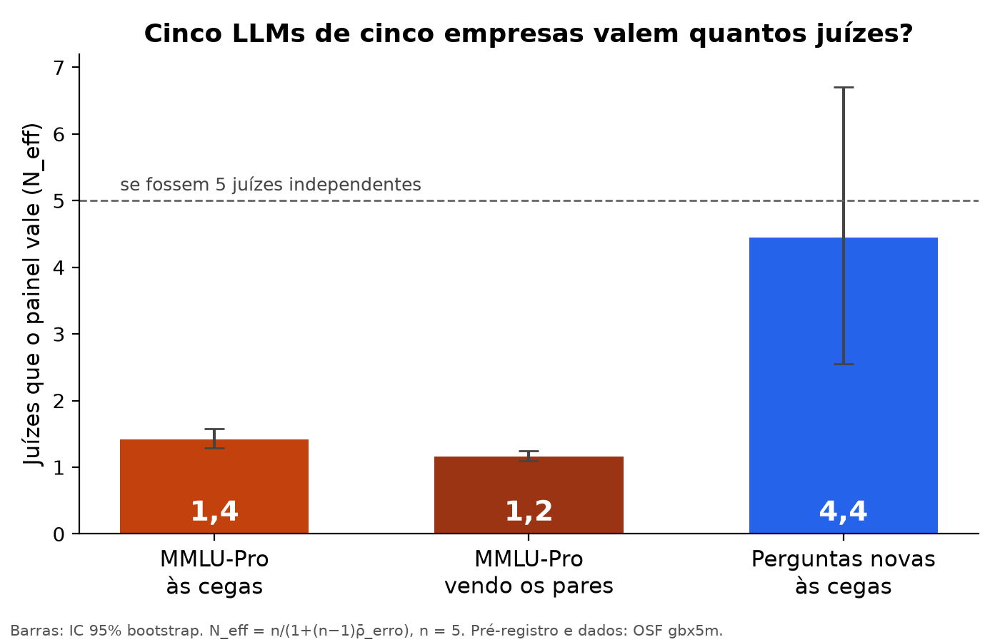

# Five LLM judges are worth 1.4 judges

Draft 1, 15/11/2026. Leitura pendente — proprietário. English version of `post-hf-pt.md`; based on text 2 (OSF gbx5m), no new numbers.

Using several LLMs as judges rests on a simple idea: five opinions beat one. That only holds if the models make independent errors. We measured how much they don't.

## What we did

Five models from five companies (Gemma, Qwen, Nemotron, Mistral and Muse) answered 140 MMLU-Pro questions, one per call, first blind and then seeing each other's answers. The design was pre-registered on OSF before data collection.

The measure is the error correlation between each pair of models (ρ̄), converted into an effective number of judges:

N_eff = n / (1 + (n − 1) ρ̄)

If errors are independent, five judges are worth five. If they are identical, they are worth one.

## What we found

- **Blind, the five are worth 1.4 judges** (95% CI 1.3 to 1.6).
- **After seeing each other, they are worth 1.2.** Exposure pulls the errors even closer.
- **Adding models barely helps.** At the measured correlation, not even infinitely many models would exceed 1.6 judges.
- **Five copies of the same model** (Gemma) give a correlation of 0.85; five models from different companies, 0.64. Diversifying vendors helps less than it seems.
- **On new questions written for the experiment, the picture changes:** errors barely correlate (4.4 judges). But those questions were easier (5% error vs 28%), and our data cannot separate "new" from "easy".

## Why it matters

Many papers validate results with "two judges agreed" or "a five-model panel voted". If errors move together, that agreement is worth much less than it looks. Anyone using an LLM panel should report N_eff, not just the number of models.

## Disclosed up front

- Data were collected with software I wrote (Norvald Lab). The analysis code and data are open.
- We found faulty answer keys in MMLU-Pro that inflate shared error; they are listed in discussion #57 of the dataset. Excluding the 7 suspect questions, the correlation drops from 0.64 to 0.57 and the conclusion holds.

## Links

- Full text and pre-registration: osf.io/gbx5m
- Code and data: [link TBD — etapa 4]

Eduardo Guedes, independent researcher · ORCID 0009-0003-9960-3337
