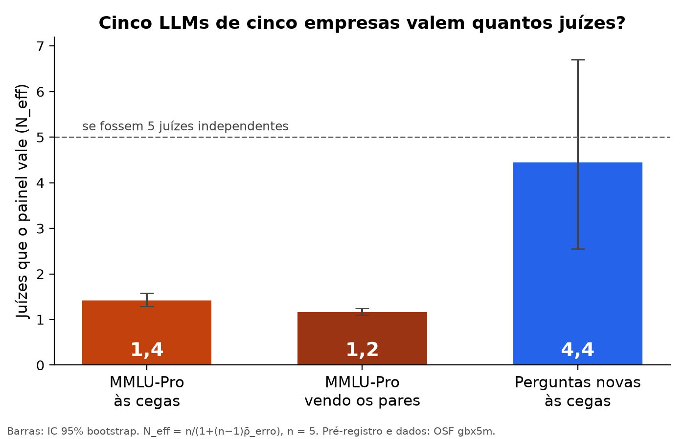

# Cinco LLMs como juízes valem 1,4 juízes

Rascunho 1, 15/11/2026. Leitura pendente — proprietário. Base: texto 2 (OSF gbx5m), sem número novo.

Usar vários LLMs como juízes parte de uma ideia simples: cinco opiniões são melhores que uma. Isso só vale se os modelos errarem de forma independente. Medimos quanto.

## O que fizemos

Cinco modelos de cinco empresas (Gemma, Qwen, Nemotron, Mistral e Muse) responderam 140 perguntas do MMLU-Pro, uma por chamada, primeiro às cegas e depois vendo as respostas uns dos outros. O desenho foi pré-registrado no OSF antes da coleta.

A medida é a correlação dos erros entre cada par de modelos (ρ̄), convertida em número efetivo de juízes:

N_eff = n / (1 + (n − 1) ρ̄)

Se os erros forem independentes, cinco juízes valem cinco. Se forem idênticos, valem um.

## O que achamos

- **Às cegas, os cinco valem 1,4 juízes** (IC 95% de 1,3 a 1,6).
- **Depois de se verem, valem 1,2.** A exposição aproxima ainda mais os erros.
- **Acrescentar modelos quase não ajuda.** Com a correlação medida, nem infinitos modelos passariam de 1,6 juízes.
- **Cinco cópias do mesmo modelo** (Gemma) dão correlação de 0,85; os cinco de empresas diferentes, 0,64. Diversificar empresa ajuda menos do que parece.
- **Em perguntas novas, escritas para o experimento, o quadro muda:** os erros quase não se correlacionam (4,4 juízes). Mas eram perguntas mais fáceis (5% de erro, contra 28%), e os nossos dados não separam "nova" de "fácil".

## Por que importa

Muitos trabalhos validam resultados com "dois juízes concordaram" ou "o painel de cinco modelos votou". Se os erros andam juntos, essa concordância vale bem menos do que parece. Quem usa painel de LLMs devia reportar o N_eff, não só o número de modelos.

## Declarado de saída

- A coleta foi feita com um software meu (Norvald Lab). O código das análises e os dados estão abertos.
- Achamos gabaritos com defeito no MMLU-Pro que inflam o erro em comum; estão na discussão #57 do dataset. Sem as 7 perguntas suspeitas, a correlação cai de 0,64 para 0,57 e a conclusão não muda.

## Links

- Texto completo e pré-registro: osf.io/gbx5m
- Código e dados: [link a definir — etapa 4]

Eduardo Guedes, pesquisador independente · ORCID 0009-0003-9960-3337
